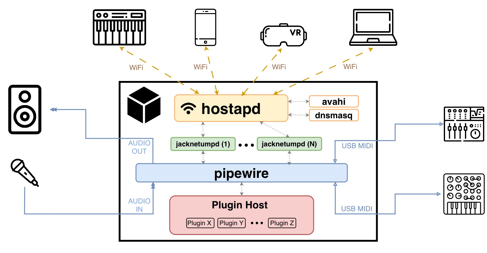
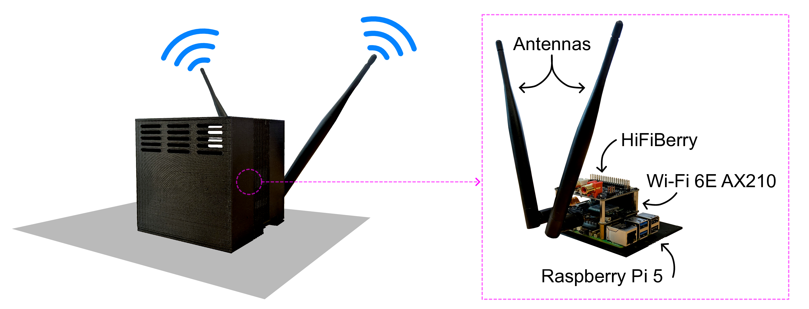
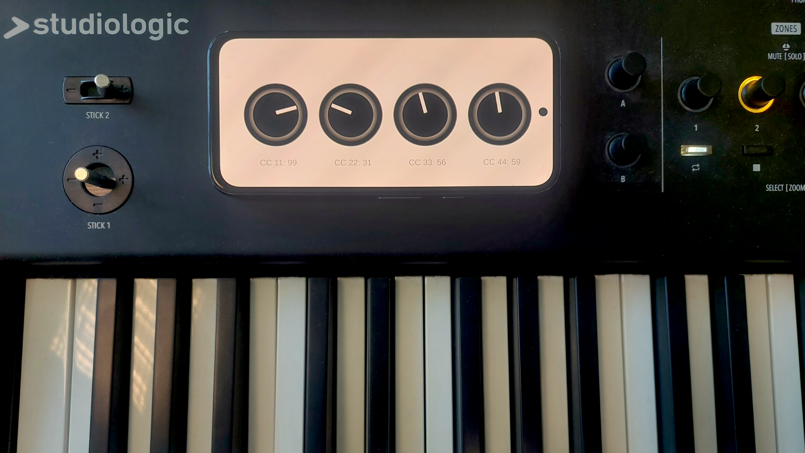
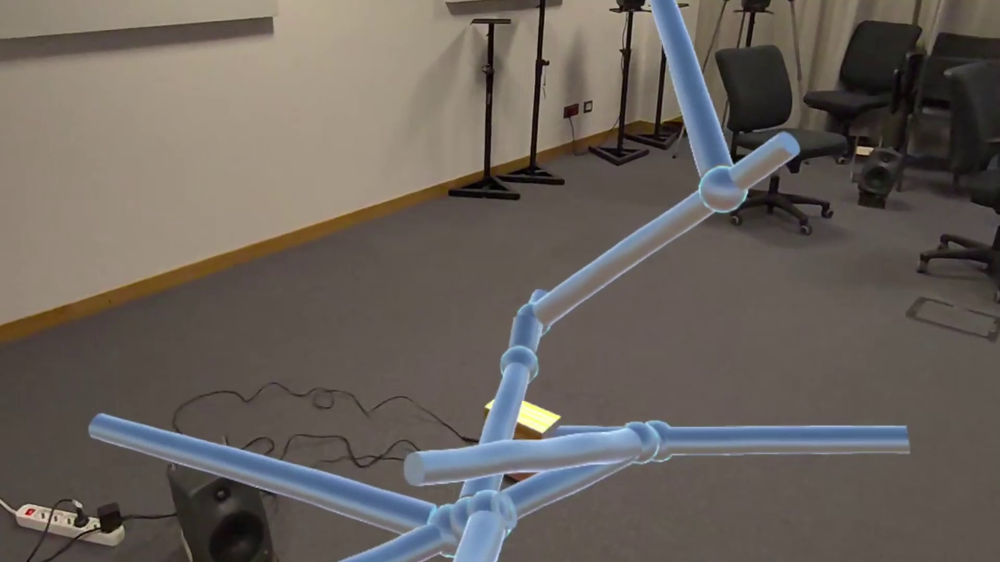
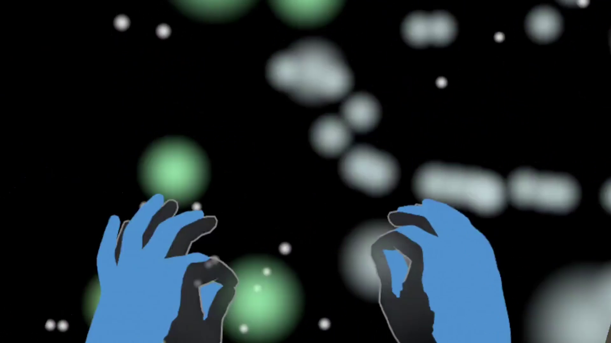

# Nexus Muse: The Muse Cube Platform

[](https://www.raspberrypi.com/)
[](https://kernel.org/)
[](https://www.midi.org/)
[](https://pipewire.org/)
[](https://www.intel.com/)
[](static/paper.pdf)

> **Nexus Muse** is an open technical framework for developing co-located interactive networked music systems based on **Universal MIDI Packets (UMP)** and the **Network MIDI 2.0** transport extension. This repository contains the complete reference hardware schematics, software stack, configuration files, and systemd deployment recipes for the **Muse Cube** embedded platform.

---



---

## Table of Contents

- [Overview](#overview)
- [The Nexus Muse Framework Ecosystem](#the-nexus-muse-framework-ecosystem)
- [Hardware Architecture & Reference Build](#hardware-architecture--reference-build)
- [System Configurations & Featured Use Cases](#system-configurations--featured-use-cases)
  - [Configuration A: Distributed Control Surfaces](#configuration-a-distributed-control-surfaces)
  - [Configuration B: Immersive Visualization](#configuration-b-immersive-visualization)
  - [Configuration C: XR MIDI Controller](#configuration-c-xr-midi-controller)
- [Repository Structure](#repository-structure)
- [Academic Citation](#academic-citation)
- [License & Acknowledgments](#license--acknowledgments)

---

## Overview

Over the past four decades, MIDI 1.0 has defined digital music connectivity. However, its 1983 technical constraints—31.25 kBaud serial DIN transmission, 7-bit quantization (0–127), and 16 channels—frequently force developers of networked music systems to adopt fragmented, ad-hoc protocols (such as raw OSC or custom WebSockets). This creates severe interoperability barriers across instruments, computing platforms, and interactive media.

**Nexus Muse** addresses this fragmentation by establishing **Universal MIDI Packets (UMP)** and **Network MIDI 2.0** as the universal communication backbone:
- **Universal MIDI Packets (UMP)**: 32-, 64-, 96-, or 128-bit packets delivering 32-bit resolution, 256 channels (16 groups × 16 channels), embedded timestamps, and native backwards compatibility with legacy MIDI 1.0.
- **Network MIDI 2.0**: A low-latency UDP transport layer incorporating Forward Error Correction (FEC), packet sequencing, selective retransmission, and mDNS/DNS-SD zero-conf discovery.
- **The Muse Cube Dual Role**:
  1. **Dedicated Wireless Access Point**: Generates an isolated, portable Wi-Fi 6E WLAN without needing external routers, internet access, or campus network infrastructure—guaranteeing deterministic latency and zero traffic contention.
  2. **Central Processing Hub**: Serves as a real-time host executing synthesizer plugins, translating Network UMP to local PipeWire/JACK streams, and coordinating multi-client routing.

---

## The Nexus Muse Framework Ecosystem

The framework comprises three loosely coupled components that can be used together or independently:

| Component | Description | Repository |
|---|---|---|
| **Muse Cube Embedded Platform** | The reference hardware/software hub for networking, routing, and audio plugin execution (*this repository*). | [CIMIL/nexus-cube-platform](https://github.com/CIMIL/nexus-cube-platform) |
| **NetUMP Unity Plugin** | C# cross-platform wrapper around the native C++ `NetUMP` library for XR (Meta Quest), mobile, and desktop interactive 3D applications. | [CIMIL/NetUMP_Unity](https://github.com/CIMIL/NetUMP_Unity) |
| **Networked JUCE Template** | Production-ready real-time C++ audio application and VST3/AU plugin template integrating Network MIDI 2.0. | [CIMIL/Networked_JUCE_Template](https://github.com/CIMIL/Networked_JUCE_Template) |

### Supporting Core Libraries
- **[NetUMP](https://github.com/CIMIL/NetUMP)**: Core cross-platform C++ library implementing the Network MIDI 2.0 protocol and UMP serialization.
- **[jacknetumpd](https://github.com/filippodaniotti/jacknetumpd)**: High-performance daemon translating Network MIDI 2.0 UDP datagrams to and from JACK / PipeWire MIDI ports.
- **[Networked SoundFont Player](https://github.com/CIMIL/Networked_SoundFont_Player)**: JUCE-based networked sound engine for standalone embedded synthesizers.

---

## Hardware Architecture & Reference Build

The Muse Cube is constructed from commercial off-the-shelf (COTS) components to guarantee accessibility, modularity, and rapid reproduction:



### Bill of Materials (BOM)

| Component | Hardware Specification | Purpose / Notes |
|---|---|---|
| **Single-Board Computer** | **Raspberry Pi 5** (8GB recommended) | Quad-core ARM Cortex-A76 @ 2.4 GHz handling networking, UMP routing, and audio synthesis. |
| **Audio Interface HAT** | **HiFiBerry DAC2 ADC Pro** | High-fidelity stereo analog I/O (up to 192 kHz / 24-bit), Burr-Brown DAC/ADC, hardware volume control. |
| **Expansion HAT** | **Waveshare PCIe to M.2 E Key HAT** | Connects high-throughput M.2 expansion cards directly to the Raspberry Pi 5 PCIe interface. |
| **Wireless NIC** | **Waveshare Intel AX210 (M.2 2230)** | Wi-Fi 6E (802.11ax, 6 GHz band), Bluetooth 5.3, supporting dedicated access point mode with low latency. |
| **Antennas** | Dual 2.4 / 5 / 6 GHz omni-directional antennas | Low-attenuation antennas for stable multi-client wireless coverage. |
| **Storage & Power** | MicroSD / NVMe + Official 27W USB-C PD | Dedicated power supply preventing brownouts under concurrent DSP and RF load. |
| **Enclosure** | Custom 3D-printed chassis | Enclosure schematics and STL models located in [`hardware/case/`](hardware/). |

> [!TIP]
> The hardware design is fully modular. You can replace the internal audio HAT with an external USB audio interface, or utilize Gigabit Ethernet instead of the Wi-Fi 6E NIC if fixed cabling is preferred.

---


## System Configurations & Featured Use Cases

The repository includes pre-built system configurations reflecting the use cases presented in the research paper:

### Configuration A: Distributed Control Surfaces
*(Path: [`examples/distributed_control_surfaces/`](examples/distributed_control_surfaces/))*



- **Scenario**: An Android smartphone touchscreen controller and a networked MIDI keyboard interact simultaneously with a single sound engine running on the Cube.
- **Topology**:
  - Performer A plays notes on a Studiologic SL73 mk2 keyboard connected via USB to a headless Raspberry Pi 5 running the [Networked SoundFont Player](https://github.com/CIMIL/Networked_SoundFont_Player).
  - Performer B shapes filter resonance, cutoffs, and expression using an Android Unity application running the [NetUMP Unity plugin](https://github.com/CIMIL/NetUMP_Unity).
  - The Cube routes both streams to the `mda JX10` VST3 synthesizer hosted inside Sushi.

---

### Configuration B: Immersive Visualization
*(Path: [`examples/immersive_visualization-xr_midi_controller/`](examples/immersive_visualization-xr_midi_controller/))*



- **Scenario**: Real-time generative visual score generated by MIDI performance in Extended Reality (XR).
- **Topology**:
  - Performers trigger musical events on the keyboard or controller.
  - A Meta Quest 3 HMD subscribes to the UMP multicast stream as a pure consumer endpoint.
  - Notes accrete into a persistent 3D crystalline structure in virtual space without placing any processing burden or audio buffer latency onto the audio signal path.

---

### Configuration C: XR MIDI Controller
*(Path: [`examples/immersive_visualization-xr_midi_controller/`](examples/immersive_visualization-xr_midi_controller/))*



- **Scenario**: Interactive gestural MIDI controller using optical hand tracking in 3D space.
- **Topology**:
  - A performer wearing a Meta Quest 3 interacts with a 600-particle simulated cosmic field running at 90 Hz.
  - Hand pinch and elevation generate MIDI Note On and velocity messages; lateral hand motion emits continuous Control Change (CC) messages.
  - MIDI is transmitted over Network MIDI 2.0 to the Cube, which renders the sound and sends acoustic feedback back to the space.

---

### Configuration D: AI-Assisted Performance Loop

- **Scenario**: Musician-AI co-improvisation over a shared symbolic stream.
- **Topology**:
  - A human performer plays melodic lines on a networked MIDI controller.
  - A symbolic AI improviser (e.g. real-time Markov model or neural sequence model) running on the Cube listens to incoming Note On/Off events.
  - The AI generates accompanying polyphonic responses in real-time and injects them back into the shared PipeWire / Sushi sound engine.

---

## Repository Structure

```text
nexus-cube-platform/
├── README.md                                    # Root repository documentation (this file)
├── hardware/
│   └── README.md                                # Reference hardware BOM, HATs & 3D enclosure notes
├── software/
│   ├── README.md                                # Software stack overview
│   ├── kernel/
│   │   └── README.md                            # RT Linux kernel (PREEMPT_RT) & UMP build guide
│   ├── raspap/
│   │   ├── README.md                            # Wireless AP setup & hostapd LAR patch guide
│   │   ├── hostapd-2.10-lar.patch               # Patch resolving regulatory domain assignment bug
│   │   ├── hostapd.conf                         # hostapd configuration template
│   │   ├── 090-wlan0.conf                       # dnsmasq DHCP/DNS configuration template
│   │   ├── firewall-rules.sh                    # iptables forwarding script
│   │   └── docker-compose.yaml                  # Optional containerized RaspAP stack
│   ├── avahi/
│   │   └── README.md                            # mDNS Bonjour service publication guide
│   ├── jacknetumpd/
│   │   └── README.md                            # Network MIDI 2.0 daemon usage & build instructions
│   └── pluginhost/
│       └── README.md                            # PipeWire, WirePlumber & Sushi/REAPER routing
├── examples/
│   ├── distributed_control_surfaces/            # Use Case A: Mobile CC + Keyboard + Synth
│   │   ├── README.md                            # Setup instructions
│   │   ├── nexus.json                           # Sushi VST3 engine configuration
│   │   ├── sushi_nexus.sh                       # Launch script & PipeWire wiring
│   │   ├── sushi.service                        # systemd service unit for Sushi
│   │   ├── jacknetumpd-keyboard.service         # systemd unit for keyboard endpoint
│   │   ├── jacknetumpd-keyboard-mdns.service    # systemd unit for keyboard mDNS
│   │   ├── jacknetumpd-smartphone.service       # systemd unit for smartphone endpoint
│   │   └── jacknetumpd-smartphone-mdns.service  # systemd unit for smartphone mDNS
│   └── immersive_visualization-xr_midi_controller/ # Use Cases B & C: XR Visualization & Controller
│       ├── README.md                            # Setup instructions
│       ├── nexus.json                           # Sushi VST3 engine configuration
│       ├── sushi_nexus.sh                       # Launch script & PipeWire wiring
│       ├── sushi.service                        # systemd service unit for Sushi
│       ├── jacknetumpd-keyboard.service         # systemd unit for keyboard endpoint
│       ├── jacknetumpd-keyboard-mdns.service    # systemd unit for keyboard mDNS
│       ├── jacknetumpd-hmd.service              # systemd unit for Quest 3 HMD endpoint
│       └── jacknetumpd-hmd-mdns.service         # systemd unit for Quest 3 HMD mDNS
└── static/
    ├── paper.pdf                                # Academic research publication
    ├── muse-cube-system-architecture.jpg        # System architecture diagram
    ├── muse-cube-hardware-diagram.png           # Hardware assembly schematic
    ├── smartphone-controller.png                # Distributed control surface screenshot
    ├── growth-screenshot.png                    # XR immersive visual score screenshot
    └── acctractor-screenshot.png                # XR gestural attractor controller screenshot
```

---

## Academic Citation

If you use the Muse Cube platform or the Nexus Muse framework in your research, please cite our paper:

```bibtex
@article{giudici2025nexusmuse,
  title     = {Nexus Muse: a Technical Framework for Interactive Networked Music Systems using Universal MIDI Packets},
  author    = {Giudici, Gregorio Andrea and Daniotti, Filippo and Boem, Alberto and Turchet, Luca},
  journal   = {Department of Information Engineering and Computer Science, University of Trento},
  year      = {2025},
  url       = {static/paper.pdf}
}
```

The paper is included directly in this repository at [`static/paper.pdf`](static/paper.pdf).

---

## License & Acknowledgments

- **Software & Configurations**: Open-source under standard permissive terms (refer to individual package directories).
- Developed at the **Creative Informatics and Multimedia Interaction Lab (CIMIL)**, Department of Information Engineering and Computer Science, **University of Trento**.
